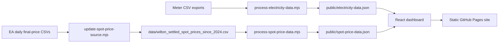

# Architecture

## Overview

The Electricity Usage Explorer is a client-side React dashboard backed by two generated JSON datasets. Meter readings and settled wholesale prices are prepared by Node scripts before the site is built. The browser loads the JSON files as static assets and performs filtering, aggregation, charts, and tariff comparisons locally.

## Application

- [`app/page.tsx`](../app/page.tsx) is the usage dashboard. It loads `electricity-data.json`, then calculates time-series summaries, tariff categories, heat maps, and demand profiles in the browser.
- [`app/cost-comparison.tsx`](../app/cost-comparison.tsx) loads `spot-price-data.json` for the cost comparison view. It matches spot prices and meter readings by interval slot and compares the configured tariff model with a configurable spot-plan model.
- [`app/layout.tsx`](../app/layout.tsx) and [`app/globals.css`](../app/globals.css) provide document metadata and shared styling.
- [`src/pages-main.tsx`](../src/pages-main.tsx) mounts the same `app/page.tsx` React component for the static Pages build. `index.html` supplies its root element.

Both datasets use 30-minute interval slots from a fixed 1 January 2024 base. Usage rows are `[slot, controlledKwh, uncontrolledKwh]`; spot rows are `[slot, priceCentsPerKwh]`. The slot axis represents the dashboard's local wall-clock sequence. Its ISO timestamps use `Z` as an encoding for that stable axis, not as a claim that source readings were collected in UTC.

## Data preparation

### Meter readings

[`scripts/process-electricity-data.mjs`](../scripts/process-electricity-data.mjs) combines the two historical exports with monthly `electricity-interval-meter-readings_YYYYMMDD_HHMMSS.csv` files in `data/`. Later-sorted monthly exports win when they overlap earlier sources. Registers are mapped to controlled and uncontrolled kWh; private identifiers are not copied into the generated JSON. Duplicate source readings are collapsed, and missing internal slots are zero-filled so the dashboard receives a continuous slot axis. Metadata records duplicate counts, filled counts, and the periods that were filled.

### Spot prices

[`scripts/update-spot-price-source.mjs`](../scripts/update-spot-price-source.mjs) reads the last date in the processed meter JSON and downloads the Electricity Authority's daily final-price CSVs for point of connection `WIL0331`. It excludes interim files, checks that each day has the expected number of trading periods, and updates the collated spot-price source CSV only after all requested days validate. It refreshes the existing tail as well as extending the data, allowing recently published final prices to replace older rows.

[`scripts/process-spot-price-data.mjs`](../scripts/process-spot-price-data.mjs) converts the collated CSV into sorted interval-slot and price pairs in `public/spot-price-data.json`. The dashboard only compares intervals with both a meter reading and an available price.

## Development and deployment builds

`npm run dev` uses the Vinext and Cloudflare Vite plugins for local application development. The GitHub Pages build uses [`vite.pages.config.ts`](../vite.pages.config.ts), which builds `index.html` and `src/pages-main.tsx` directly with Vite while reusing the React dashboard component and `public/` assets. The Pages build is static; it does not require the Cloudflare Worker or D1 database scaffolding.
